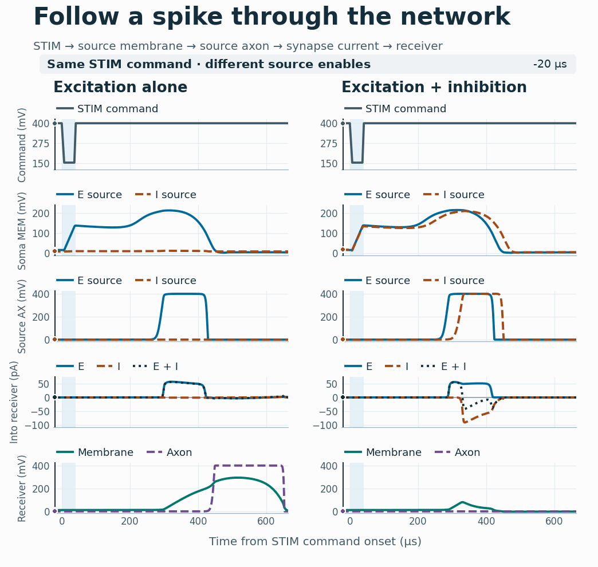

# Analogue SNN Building Blocks

This chip lets you watch a neuron fire, measure what each kind of synapse
does on its own, and see how excitation and inhibition shape the response
of a connected network. The neural circuits run continuously without a
clock.

[Four analogue pins](#four-pins) · [Try the chip](#how-to-test) · [Datasheet](docs/info.md)

## How it works

The soma integrates incoming current on a membrane capacitor. When the
membrane voltage reaches threshold, the neuron sends a spike along its
axon. The soma then discharges the capacitor so the neuron can fire again.

[Still image](docs/soma-firing.png)

Each of the two source neurons connects to the receiver through a synapse.
A spike from the excitatory source adds current to the receiver. A spike
from the inhibitory source draws current away. Each synapse stores its
weight as charge on a floating gate. That weight sets how much current the
synapse contributes when a spike arrives.

[Still image](docs/follow-a-spike.png)

In the simulated network example, inhibition keeps the receiver quiet
with the same stimulus that makes it fire under excitation alone.

## Four pins

| Macro pin | Name | What it does |
| --- | --- | --- |
| `ua[0]` | R | 0.400 V supply for the neural circuit |
| `ua[1]` | H | Reference and programming input. Use 0.420 V at park and 1.000 V for readout. |
| `ua[2]` | AOUT | Buffered analogue output for a high-impedance scope |
| `ua[3]` | STIM | Input for an external stimulus pulse |

Use the shuttle’s mux map to find the corresponding board connectors.
The board supplies 1.800 V on VDPWR and provides VGND.
[Tiny Tapeout analogue pin guide](https://tinytapeout.com/specs/analog/#analog-pins)

## How to test

1. **Soma.** Stimulate the receiving soma directly and watch the membrane
   voltage rise and reset.
2. **Soma and axon.** Repeat the stimulus with AOUT switched to the axon
   to see the outgoing spike.
3. **Excitatory synapse.** Stimulate the standalone excitatory cell and
   use the calibrated readout to measure the positive current.
4. **Inhibitory synapse.** Repeat with the standalone inhibitory cell
   to measure the negative current.
5. **Connected network.** Send the same pulse with both sources off,
   with excitation alone, and with excitation and inhibition together.
   Compare the receiver's response.

AOUT shows one signal at a time. The [datasheet bench steps](docs/info.md#how-to-test)
give the settings for each experiment.
