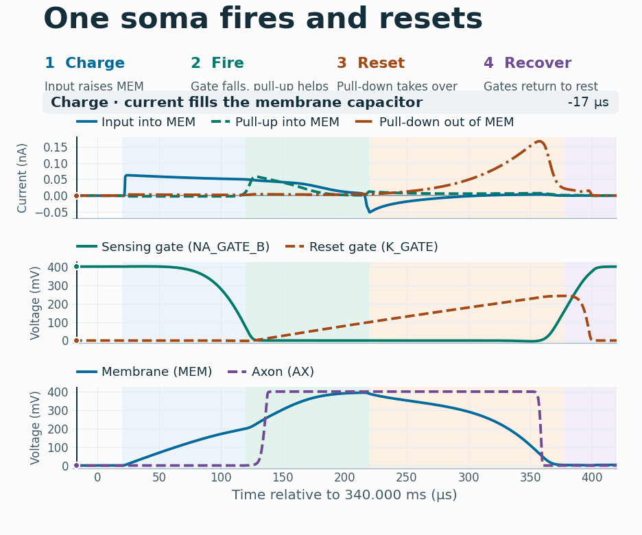

# Analogue SNN Building Blocks

This project builds analogue circuits for spiking neural networks, where
neurons communicate through brief voltage pulses. The Tiny Tapeout test chip
brings neurons and synapses together in a small network that runs without a clock.

[Four pins](#four-pins) · [Bench tests](#how-to-test) · [Tiny Tapeout datasheet source](docs/info.md)

[Soma still figure](docs/soma-firing.png) · Open either replay for a larger view.

**Revision check.** The reservation `6c416f7` grounds all four analogue pins.
Leave them undriven on that revision. The experiments below use the functional 1×2 tile.

## How it works

**Watch one soma fire.** The soma is the part of a neuron that charges up and fires.
MEM is the voltage on its membrane capacitor. Follow the moving dots down the three plots.

1. **Charge.** Input current raises MEM first. The axon is still low.
2. **Fire.** Rising MEM pulls the sensing gate (`NA_GATE_B`) low. The pull-up adds current, MEM rises faster and the axon goes high.
3. **Reset.** The delayed reset gate (`K_GATE`) rises. It shuts off the pull-up path and turns on the pull-down, which discharges MEM. The axon goes low.
4. **Recover.** As MEM falls, the sensing gate rises and the reset gate drops. The soma can charge again.

*Extracted SKY130A receiver simulation at 25 °C and R = 0.400 V. The time origin is 340.000 ms into that run.*

**Follow the spike.** Both columns use the same STIM command. Read from top to bottom.

[Network still figure](docs/follow-a-spike.png)

- **Source soma → axon.** STIM charges each enabled source soma. Its axon carries the voltage spike to its synapse.
- **Axon → synapse → dendrite.** The axon enables a current set by the synapse’s stored floating-gate charge. E supplies current to the receiving dendrite. I draws current out. The dotted trace is the sum of the two synapse currents.
- **Dendrite → receiver.** With E alone, the receiving membrane charges enough to fire. With E and I active, E first raises the membrane. I then pulls the sum below zero and the receiver stays quiet.

*Whole-tile simulations from the earlier Stage03 extraction at 25 °C and R = 0.400 V with a finite bench load and preset synapse weights. These plots show internal model signals. On the bench, use AOUT to watch the receiver.*

## Four pins

| Macro pin | Name | Bench connection |
| --- | --- | --- |
| `ua[0]` | R | 0.400 V supply for the neural circuit |
| `ua[1]` | H | Reference feed for readout. Use 0.420 V at park and a nominal 1.000 V read command. |
| `ua[2]` | AOUT | Buffered readback to a high-impedance scope |
| `ua[3]` | STIM | External stimulus from a pulse generator |

Use the delivered shuttle’s mux map to find the board connectors for these macro pins.
The board supplies 1.800 V on VDPWR and provides VGND. [Tiny Tapeout analogue pin guide](https://tinytapeout.com/specs/analog/#analog-pins)

## How to test

Digital words are hexadecimal `UI / UIO`. Keep programming requests `uio[2]`, `uio[3]` and `uio[5]` low throughout.

1. **Park and check.** Select the functional tile. Follow the board’s power-up order with `ena` low and reset asserted. Start at `00 / 00` with H at 0.420 V park. Release reset and enable the tile with `clk` low. Check feed currents and that AOUT is disconnected before changing to a read word.
2. **Take a quiet trace.** Commission AOUT and STIM as described in [the bench procedure](docs/info.md#how-to-test). Use `53 / 00` to observe the receiving axon at AOUT with both sources off. Apply the same commissioned STIM pulse in tests 2–4.
3. **Enable E.** Set `57 / 40` and repeat the pulse. Look for a receiver spike after STIM returns to park.
4. **Enable E and I.** Set `5F / 40` and repeat the pulse. With weights comparable to the simulation, AOUT stays near its quiet level. The starting weights on silicon can differ from the model presets.

Between tests, return STIM to park, open the AOUT route and turn off delivery before changing the selection. Let the new route settle and allow the receiver to recover before pulsing again.

The corrected route03 extraction resolved an imposed inhibitory
floating-gate charge change through calibrated AOUT while the excitatory
cell remained steady. Writing and retention are separate powered silicon
experiments.
