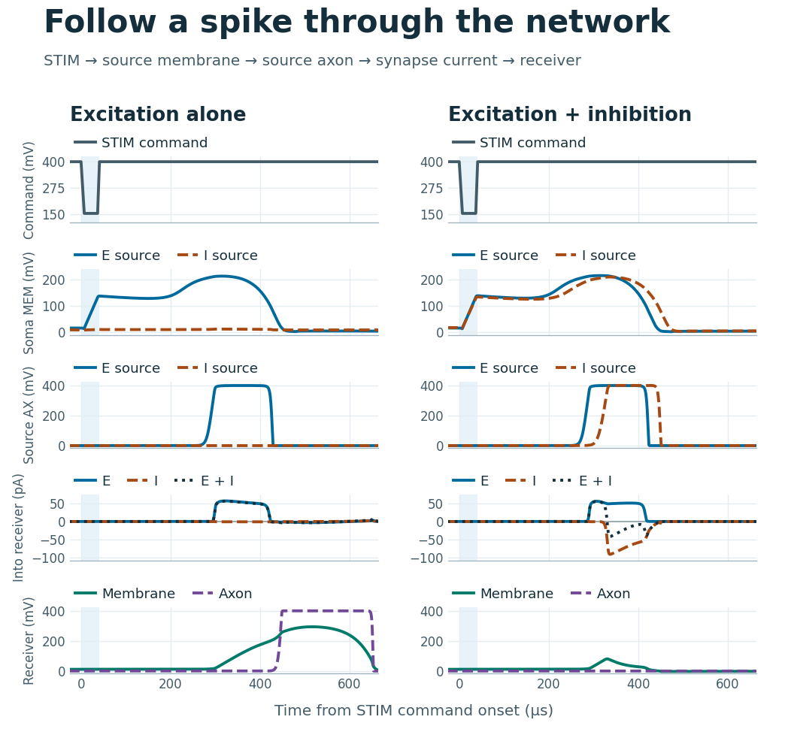

## How it works

STIM drives two source neurons. Static GPIO selects which source can excite (E) or inhibit (I) the receiving neuron.

- Current charges the soma’s membrane capacitor (MEM). As MEM rises, the sensing gate falls and the pull-up drives an axon spike.
- The delayed reset gate turns off the pull-up and turns on the pull-down. MEM discharges and the axon returns low.

- At each synapse, an axon spike enables a current set by stored floating-gate charge. E adds current to the receiving dendrite and I draws current out.
- The same STIM pulse fires the receiver with E alone. With E and I, the dotted current sum dips below zero and the receiver axon stays low.

## How to test

**Check the revision first.** The submitted reservation `6c416f7` grounds `ua[0]` through `ua[3]`. Leave those pins undriven. These steps apply to the released functional tile. Use the shuttle’s mux map to locate its board connectors.

| Macro pin | Name | Connection |
| --- | --- | --- |
| `ua[0]` | R | 0.400 V neural supply |
| `ua[1]` | H | 0.420 V at park, nominal 1.000 V read command |
| `ua[2]` | AOUT | Buffered receiver readback to scope |
| `ua[3]` | STIM | External pulse generator |

Words are hex `UI/UIO`. Keep `clk` and programming requests `uio[2]`, `uio[3]` and `uio[5]` low. Before changing routes, park STIM, open AOUT and turn off delivery. Settle the new route before reconnecting AOUT.

1. **Power and park.** Follow the board power-up order with `ena` low, reset asserted, H at 0.420 V and `10/00`. Enable the tile and release reset. Check feed currents and AOUT isolation.
2. **Calibrate.** Set H to 1.000 V. At `48/00`, fit AOUT at 190 and 210 mV STIM and check an interior level. Compare current-read blank `84/00` with CAL `A4/00`. Fit the change in AOUT against connector current and check a point of each sign. Check the VI input clamp separately at `64/00`.
3. **Survey STIM.** With MEM isolated, compare positive delivery `84/50` with blank `84/40`. Measure loaded STIM. Start with small commands in the surveyed range.
4. **Observe quiet.** Apply a commissioned pulse at `53/00`. AOUT shows the receiver axon with both sources off. The model command falls from 399 to 153.41 mV in 7 µs, holds 30 µs and returns in 4 µs.
5. **Enable E.** Repeat the pulse at `57/40`. Look for a receiver spike. Use `47/40` for a separate MEM trace.
6. **Enable E and I.** Repeat at `5F/40` with the same pulse, supplies and load. Look for a quiet axon. Use `4F/40` for MEM. Recover between pulses. The model used E and I floating-gate presets of 0.225 V and 0.125 V. Record the starting silicon response.

## External hardware

- Tiny Tapeout demo board with analogue mux, 1.800 V VDPWR and VGND.
- Current-limited R and H supplies that can sink current, a pulse generator, voltage and current meters, and a high-impedance scope probe with a Kelvin return.
- The model fixture used a 502 Ω H feed, a 0.1 Ω return and a 100 MΩ / 24 pF AOUT load. Log the board, cable and probe loading.
