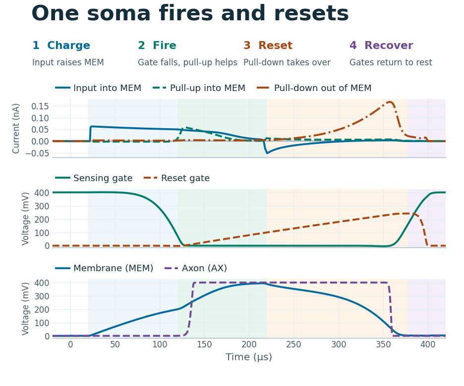

## How it works

You can drive the receiving soma directly and watch its membrane charge
and reset. Switch AOUT to the axon and repeat the stimulus to see the
outgoing spike.

Two source neurons feed the receiver. One synapse adds current and the
other draws it away. Floating-gate charge sets each synapse's strength.

Two standalone cells let you read the excitatory and inhibitory currents
separately and apply programming pulses from H.

## How to test

Use the shuttle’s mux map to find these four pins on the board.

| Macro pin | Name | What it does |
| --- | --- | --- |
| `ua[0]` | R | 0.400 V neural supply |
| `ua[1]` | H | Reference and programming input |
| `ua[2]` | AOUT | Buffered analogue output |
| `ua[3]` | STIM | Stimulus input |

Settings are hexadecimal `UI / UIO` words. Keep `clk` and the
programming inputs `uio[2]`, `uio[3]` and `uio[5]` low during these
experiments.

Power up with `ena` and `rst_n` low, `00 / 00` selected, H at 0.420 V
and STIM at 0.400 V. Follow the board's power-up order. Release reset and
enable the chip. Check the supply currents before bringing H to 1.000 V
for readout. Select `48 / 00` and change STIM from 190 mV to 210 mV.
Check that AOUT follows the change.

| Experiment | UI / UIO | Read at AOUT |
| --- | --- | --- |
| Soma | `41/40` | Receiver membrane voltage |
| Soma and axon | `42/40` | Receiver axon spike |
| Excitatory synapse | `84/01` | Positive current |
| Inhibitory synapse | `84/02` | Negative current |
| Connected network | `53/00`, `57/40`, `5F/40` | Receiver axon response |

For the soma and axon, drive the receiver directly from STIM. Use
`41/00` and `42/00` for the quiet traces. In the network, the three
settings select both sources off, excitation alone, and excitation with
inhibition. For each trace, try dropping STIM from 0.400 V to about
0.153 V with a 7 µs fall, a 30 µs hold and a 4 µs return. Keep the
pulse and load the same and let the receiver recover between pulses.

For either standalone synapse, set STIM to 0.400 V for the active read
and 0 V for the inactive check. Calibrate the current readout using
`84 / 00` for the blank and `A4 / 00` to connect the 10 MΩ calibration
resistor. Take calibration readings with STIM above and below the sense
voltage. Use `64 / 00` to observe the sense voltage with the resistor
still connected. The reference current is STIM minus the sense voltage,
divided by 10 MΩ.

Subtract the blank from each cell reading before converting the AOUT
change to current. Observe the drain voltage separately at `44 / 01`
for excitation and `44 / 02` for inhibition. Compare readings at the
same drain bias.

Between modes, park STIM and select `00 / 00` to turn off delivery
and open the AOUT route. Set the next word and let the readout settle
before recording.

## External hardware

Use a Tiny Tapeout demo board with an analogue mux, 1.800 V VDPWR and
VGND. You’ll need current-limited R and H supplies that can sink current,
a pulse generator and a high-impedance scope probe.
